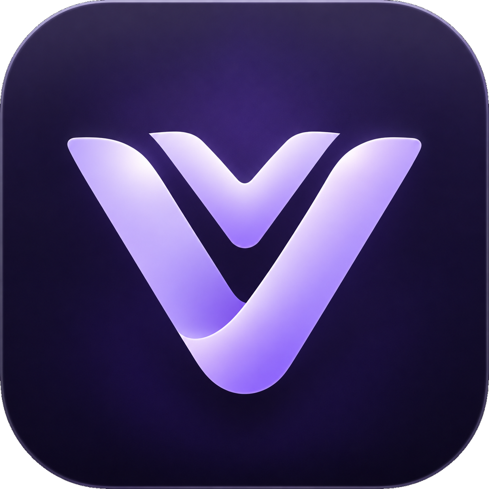

[English](README.md) · [Português (Brasil)](README.pt-BR.md)

<div align="center">


# Veyvox

**Communication for your community, on infrastructure you control.**

Chat · voice · video · screen sharing · federation · Juno

[Downloads](https://github.com/bernardokcosta/veyvox/releases) · [Documentation](docs/systems/) · [Issues](https://github.com/bernardokcosta/veyvox/issues) · [Security](SECURITY.md)

</div>

Veyvox is an independently maintained, self-hosted communication platform derived
from [Backspace](https://github.com/TheZwiss/backspace). It combines spaces and
channels, private conversations and optional voice/video with federation between
independent instances. The source tree targets **1.17.0**; download only builds
listed in the published releases.

## Start here

**Want to join a community?** You do not need to run a server:

1. Ask your community for its instance address, such as `https://chat.example.com`.
2. Open it in your browser, or download a desktop build from [Releases](https://github.com/bernardokcosta/veyvox/releases).
3. Sign in or register according to that instance's registration policy, then use its invitations to join spaces.

**Want to host your own instance?** Follow [Installation](#installation).
**Already running this fork?** Read [Updating an existing installation](#updating-an-existing-installation) first.

## Features

- **Chat and organization:** spaces, channels, roles and permission overrides; Markdown, replies, reactions, attachments, search and unread indicators.
- **Private conversations:** friends, direct messages and group DMs; optional voice/video calls.
- **Voice, video and screen sharing:** optional LiveKit integration, quality controls, per-person/per-stream volume, push-to-talk and noise suppression. Availability depends on your server, OS, browser and hardware.
- **Federation:** connect independent instances for supported friends, messages, calls and presence; accounts and permissions remain instance-aware.
- **Juno and soundboard:** play Juno in space voice channels and use personal sound shortcuts. Juno's original rules, art, music and Portuguese dubbing are preserved.
- **25 interface languages:** automatic system-language selection or an explicit choice, including Brazilian Portuguese and Arabic RTL.
- **Web, desktop and mobile:** responsive web client, Electron desktop app and installable mobile PWA.
- **Operator tools:** registration/moderation controls, SQLite snapshots, backup/restore tooling and source-version information.

## Desktop app

Use [Releases](https://github.com/bernardokcosta/veyvox/releases) to select a **published** build for your machine:

| Platform | 1.17.0 installer naming | Notes |
| --- | --- | --- |
| Windows | `Veyvox-1.17.0-win-x64.exe` / `-win-arm64.exe` | Choose your architecture; x64 is the fallback when unsure. Installers are not Authenticode-signed. |
| Linux | `Veyvox-1.17.0-linux-x86_64.AppImage` / `-linux-arm64.AppImage`; `-linux-amd64.deb` / `-linux-arm64.deb` | AppImage or Debian package; artifacts are unsigned. |
| macOS | `Veyvox-1.17.0-mac-arm64.dmg` / `-mac-x64.dmg` | Apple Silicon or Intel. Ad-hoc signed, not notarized; updates require a manual download. |

The app asks for your instance address. No central Veyvox account or public
default server is required. Updater manifests and `.blockmap` files are not
installers. Historical releases retain their original filenames.

See [desktop behavior](docs/systems/desktop.md), [signing and security limits](docs/systems/desktop-security.md)
and the [local Flatpak build guide](flatpak/README.md).

## Mobile

Open your instance in a phone browser and use **Add to Home Screen / Install**
where supported. The PWA has a touch-oriented interface and an offline outgoing
message queue. There is no native iOS or Android app-store build in this release.

## Installation

### New self-hosted instance

The supported first-time path is a Linux host with Docker/Compose, a domain and
appropriate HTTPS/network access. Docker Engine 24+ is recommended. The installer
offers all-in-one, existing reverse-proxy and tunnel modes:

```bash
git clone https://github.com/bernardokcosta/veyvox.git
cd veyvox
./install.sh
```

The installer guides you through configuration, creates secrets and starts the
stack. Protect the first registration: **the first registered account becomes the
instance administrator**. There is no default login/password.

- All-in-one uses Caddy for HTTPS and needs reachable TCP ports `80` and `443`.
- Voice/video require optional LiveKit configuration plus media ports `3478/UDP`, `7881/TCP` and `50000–60000/UDP`.
- Reverse proxies must forward WebSocket traffic and, for voice, LiveKit signaling.
- Tunnel mode does not carry the WebRTC/UDP media path; voice is disabled there.

Read [deployment and configuration](docs/systems/deployment.md), [voice setup](docs/systems/voice.md)
and [`.env.example`](.env.example) before exposing a new instance. Production's
default application port is `3000`; the proxy/installer determines public access.
Text, DMs, uploads and other non-call features do not require LiveKit.

### Updating an existing installation

**Stay in the existing installation directory.** Do not clone into a new directory,
run first-time setup as a reset, rename the Compose project, regenerate secrets,
or delete your profile/database just to change the product name.

1. Back up your database, uploads and private configuration; retain the old image/version for rollback.
2. Keep the existing `.env`, `data/`, mount paths and Compose project identity.
3. From that same directory, inspect and run the existing update tool:

```bash
./update.sh --check
./update.sh
```

For a manual image update, follow the [backup/rollback guide](docs/systems/deployment.md).
The existing service is deliberately still named `backspace`:

```bash
docker compose pull backspace
docker compose up -d backspace
```

Do **not** use `--remove-orphans` or start a second stack against the same data.
The public compatibility image remains `ghcr.io/bernardokcosta/backspace`, with
`BACKSPACE_IMAGE` / `BACKSPACE_IMAGE_TAG` overrides preserved.

Desktop upgrades reuse the community fork's existing profile and installation
identity. Internal `Backspace Fork` paths, legacy storage keys, app IDs and
`backspace://` links are intentional compatibility names; new `veyvox://` links
are also supported. Older binaries do not gain new protocol registrations by
loading a new web client. On macOS replace the existing bundle at its retained
path, rather than installing a second app. The unrelated official Backspace
profile is never automatically imported.

See [desktop compatibility](docs/systems/desktop.md) and [backup/restore](docs/systems/deployment.md)
for the full behavior and platform limitations.

## Development

Use **Node.js >=22.12.0** and **pnpm 10**. `.nvmrc` and the current CI select
Node 24. The desktop keyboard hook needs platform-native C++ build tools;
if its rebuild cannot run, installation warns and continues for server/web work.

```bash
pnpm install --frozen-lockfile
cp .env.example .env
# Set JWT_SECRET to a secure value of at least 32 characters.
# Example generator: openssl rand -hex 32
pnpm dev
```

On PowerShell use `Copy-Item .env.example .env` instead of `cp`. Development runs
the API/WebSocket server on `3005` and Vite on `5173`. You can also use
`pnpm dev:server` and `pnpm dev:web` separately.

```bash
pnpm build                 # shared → server → web, in that order
pnpm typecheck
pnpm lint
pnpm -r test
pnpm --filter @veyvox/desktop build:ts
pnpm --filter @veyvox/server typecheck:e2e
node scripts/check-i18n.mjs --strict --include-desktop
pnpm gen-icons
```

The strict TypeScript monorepo uses React 19/Vite/Tailwind/Zustand on the web,
Fastify 5/Drizzle/SQLite on the server, and Electron 45 on desktop. Workspace
packages use `@veyvox/*`. Read [AGENTS.md](AGENTS.md) and the relevant
[subsystem specification](docs/systems/) before changing behavior. No production
deployment is implied by local development commands.

## Privacy and security

Self-hosting gives your operator control over instance data, not automatic
end-to-end encryption. This release does **not** claim E2EE: trust your operator
and the instances/peers you connect to. Instance-side diagnostics and moderation
records have the limits described in [diagnostics](docs/systems/diagnostics.md).
Optional update checks, embeds, activity resources and integrations may contact
their respective services; do not assume all operations stay offline.
This rebrand preserves the existing desktop cookie-protection mode; it does not
introduce a new guarantee of at-rest cookie encryption.

Report vulnerabilities privately using the repository's GitHub security advisory
flow, not a public issue. See [SECURITY.md](SECURITY.md) and
[desktop security](docs/systems/desktop-security.md) for scanning/signing limits.

## Origin, credits and license

Veyvox is an **independently maintained community fork** of
[the original Backspace](https://github.com/TheZwiss/backspace), created by
**Jannis Braun (TheZwiss)**. Thank you to Jannis and **all contributors to the
original project** for the foundation that made this work possible.

Veyvox's maintenance, fork changes and new visual identity are independent. This
is not an official upstream rename, an upstream release or a statement of
endorsement/affiliation. The Veyvox artwork was supplied by this fork's maintainer,
not attributed to the original creator.

The code is distributed under **[GNU AGPL-3.0-only](LICENSE)**. Preserve original
copyright and license notices; bundled third-party components keep their own
licenses, recorded in [NOTICE](NOTICE). If you operate a modified network service,
offer its complete corresponding source; `BACKSPACE_SOURCE_URL` must identify the
source you actually run. Upstream's separate commercial terms do not grant a
commercial license for this independent fork or rights to upstream trademarks.

Thanks also to the contributors behind Fastify, React, Drizzle, LiveKit, Electron,
Tailwind, the bundled fonts and the wider open-source ecosystem.
