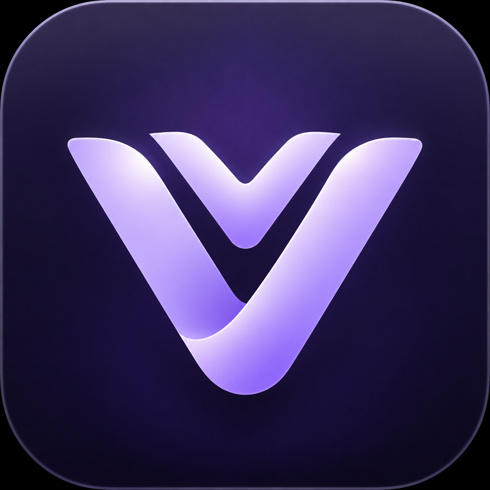

[English](README.md) · [Português (Brasil)](README.pt-BR.md)

<div align="center">


# Veyvox

**Comunicação para sua comunidade, na infraestrutura que você controla.**

Chat · voz · vídeo · compartilhamento de tela · federação · minijogos

[Downloads](https://github.com/bernardokcosta/veyvox/releases) · [Documentação](docs/systems/) · [Problemas](https://github.com/bernardokcosta/veyvox/issues) · [Segurança](SECURITY.md)

</div>

Veyvox é uma plataforma de comunicação auto-hospedada e mantida de forma
independente, derivada do [Backspace](https://github.com/TheZwiss/backspace).
Reúne espaços e canais, conversas privadas e voz/vídeo opcionais, com federação
entre instâncias independentes. Este código-fonte prepara a versão **1.17.0**;
baixe apenas as compilações presentes nas releases publicadas.

## Comece por aqui

**Quer participar de uma comunidade?** Você não precisa hospedar um servidor:

1. Peça à comunidade o endereço da instância, como `https://chat.example.com`.
2. Abra o endereço no navegador ou baixe o aplicativo para computador em [Releases](https://github.com/bernardokcosta/veyvox/releases).
3. Entre ou cadastre-se conforme as regras da instância e use os convites para participar dos espaços.

**Quer hospedar sua própria instância?** Siga [Instalação](#instalação).
**Já utiliza este fork?** Leia primeiro [Atualização de uma instalação existente](#atualização-de-uma-instalação-existente).

## Recursos

- **Chat e organização:** espaços, canais, cargos e permissões específicas; Markdown, respostas, reações, anexos, busca e indicadores de mensagens não lidas.
- **Conversas privadas:** amigos, mensagens diretas e DMs em grupo; chamadas opcionais de voz/vídeo.
- **Voz, vídeo e compartilhamento de tela:** integração opcional com LiveKit, controles de qualidade, volume por pessoa/transmissão, push-to-talk e supressão de ruído. A disponibilidade depende do servidor, sistema, navegador e hardware.
- **Federação:** conecte instâncias independentes para os recursos compatíveis de amizade, mensagens, chamadas e presença; contas e permissões continuam vinculadas às respectivas instâncias.
- **Minijogos e soundboard:** jogue minijogos como Juno nos canais de voz dos espaços e use atalhos pessoais para sons.
- **25 idiomas de interface:** seleção automática pelo sistema ou escolha manual, incluindo português brasileiro e árabe com escrita RTL.
- **Web, computador e celular:** cliente web responsivo, aplicativo Electron para computador e PWA instalável no celular.
- **Ferramentas de administração:** controles de cadastro/moderação, snapshots SQLite, backup/restauração e identificação da versão do código-fonte.

## Aplicativo para computador

Use [Releases](https://github.com/bernardokcosta/veyvox/releases) para escolher uma compilação **publicada** para sua máquina:

| Plataforma | Nomes dos instaladores da versão 1.17.0 | Observações |
| --- | --- | --- |
| Windows | `Veyvox-1.17.0-win-x64.exe` / `-win-arm64.exe` | Escolha sua arquitetura; em caso de dúvida, use x64. Os instaladores não têm assinatura Authenticode. |
| Linux | `Veyvox-1.17.0-linux-x86_64.AppImage` / `-linux-arm64.AppImage`; `-linux-amd64.deb` / `-linux-arm64.deb` | AppImage ou pacote Debian; os arquivos não são assinados. |
| macOS | `Veyvox-1.17.0-mac-arm64.dmg` / `-mac-x64.dmg` | Apple Silicon ou Intel. Assinatura ad-hoc, sem notarização; as atualizações exigem download manual. |

O aplicativo pede o endereço da sua instância. Não é necessária uma conta central
do Veyvox nem um servidor público padrão. Manifestos de atualização e arquivos
`.blockmap` não são instaladores. As releases antigas mantêm seus nomes originais.

Consulte o [funcionamento do desktop](docs/systems/desktop.md), os [limites de assinatura e segurança](docs/systems/desktop-security.md)
e o [guia de compilação local do Flatpak](flatpak/README.md).

## Celular

Abra sua instância no navegador do celular e use **Adicionar à tela inicial /
Instalar**, quando disponível. O PWA tem interface adaptada ao toque e uma fila
de mensagens de saída para períodos sem conexão. Esta versão não inclui um
aplicativo nativo nas lojas do iOS ou Android.

## Instalação

### Nova instância auto-hospedada

O caminho recomendado para a primeira instalação é um host Linux com
Docker/Compose, domínio e acesso HTTPS/rede adequados. Recomenda-se Docker Engine
24 ou superior. O instalador oferece os modos completo, proxy reverso existente
e túnel:

```bash
git clone https://github.com/bernardokcosta/veyvox.git
cd veyvox
./install.sh
```

O instalador orienta a configuração, cria os segredos e inicia os serviços.
Proteja o primeiro cadastro: **a primeira conta cadastrada torna-se administradora
da instância**. Não existe usuário ou senha padrão.

- O modo completo usa Caddy para HTTPS e precisa das portas TCP `80` e `443` acessíveis.
- Voz/vídeo exigem configuração opcional do LiveKit e as portas de mídia `3478/UDP`, `7881/TCP` e `50000–60000/UDP`.
- Proxies reversos precisam encaminhar WebSocket e, para voz, a sinalização do LiveKit.
- O modo túnel não transporta a mídia WebRTC/UDP; a voz fica desativada nesse modo.

Leia [implantação e configuração](docs/systems/deployment.md), [configuração de voz](docs/systems/voice.md)
e [`.env.example`](.env.example) antes de expor uma nova instância. A porta padrão
do aplicativo em produção é `3000`; o proxy/instalador define o acesso público.
Chat, DMs, uploads e os demais recursos sem chamadas não exigem LiveKit.

### Atualização de uma instalação existente

**Continue no diretório da instalação atual.** Não clone em outra pasta, não use
a instalação inicial como forma de reiniciar tudo, não renomeie o projeto Compose,
não recrie segredos e não apague o perfil/banco apenas para trocar a marca.

1. Faça backup do banco, uploads e configuração privada; guarde a imagem/versão anterior para reversão.
2. Preserve `.env`, `data/`, caminhos de montagem e a identidade do projeto Compose.
3. No mesmo diretório, consulte e execute a ferramenta de atualização existente:

```bash
./update.sh --check
./update.sh
```

Para atualizar a imagem manualmente, siga o [guia de backup e reversão](docs/systems/deployment.md).
O serviço existente continua intencionalmente com o nome `backspace`:

```bash
docker compose pull backspace
docker compose up -d backspace
```

**Não** use `--remove-orphans` nem inicie outra stack apontando para os mesmos
dados. A imagem pública de compatibilidade continua sendo
`ghcr.io/bernardokcosta/backspace`, com as opções `BACKSPACE_IMAGE` e
`BACKSPACE_IMAGE_TAG` preservadas.

As atualizações do desktop reutilizam o perfil e a identidade de instalação do
fork comunitário. Caminhos internos `Backspace Fork`, chaves antigas de
armazenamento, IDs do aplicativo e links `backspace://` são nomes intencionais de
compatibilidade; links novos `veyvox://` também são aceitos. Binários antigos não
ganham o registro do novo protocolo apenas por carregar um cliente web novo.
No macOS, substitua o bundle existente no caminho preservado, em vez de instalar
outro aplicativo ao lado. O perfil do Backspace oficial, que é independente
deste fork, nunca é importado automaticamente.

Consulte [compatibilidade do desktop](docs/systems/desktop.md) e [backup/restauração](docs/systems/deployment.md)
para conhecer o comportamento completo e os limites por plataforma.

## Desenvolvimento

Use **Node.js >=22.12.0** e **pnpm 10**. O arquivo `.nvmrc` e o CI atual
selecionam Node 24. O módulo de atalhos globais do desktop precisa das
ferramentas C++ nativas da plataforma; se a recompilação não puder ser feita,
a instalação avisa e continua para o trabalho no servidor/web.

```bash
pnpm install --frozen-lockfile
cp .env.example .env
# Defina JWT_SECRET com um valor seguro de pelo menos 32 caracteres.
# Exemplo de gerador: openssl rand -hex 32
pnpm dev
```

No PowerShell, use `Copy-Item .env.example .env` em vez de `cp`. O desenvolvimento
executa a API/WebSocket na porta `3005` e o Vite na `5173`. Também é possível usar
`pnpm dev:server` e `pnpm dev:web` separadamente.

```bash
pnpm build                 # shared → server → web, nessa ordem
pnpm typecheck
pnpm lint
pnpm -r test
pnpm --filter @veyvox/desktop build:ts
pnpm --filter @veyvox/server typecheck:e2e
node scripts/check-i18n.mjs --strict --include-desktop
pnpm gen-icons
```

O monorepo TypeScript estrito usa React 19/Vite/Tailwind/Zustand na web,
Fastify 5/Drizzle/SQLite no servidor e Electron 45 no desktop. Os pacotes usam
`@veyvox/*`. Leia [AGENTS.md](AGENTS.md) e a
[especificação do subsistema](docs/systems/) antes de mudar o comportamento.
Os comandos de desenvolvimento local não implicam implantação em produção.

## Privacidade e segurança

Auto-hospedagem dá ao operador controle sobre os dados da instância, mas não
garante criptografia de ponta a ponta. Esta versão **não promete E2EE**: é preciso
confiar no operador e nas instâncias/pares aos quais você se conecta. Diagnósticos
e registros de moderação têm os limites descritos em
[diagnósticos](docs/systems/diagnostics.md). Consultas opcionais de atualização,
embeds, recursos de atividade e integrações podem contatar os respectivos
serviços; não presuma que todas as operações permanecem offline.
Esta mudança de marca preserva o modo existente de proteção dos cookies do
desktop; não introduz uma nova garantia de criptografia dos cookies em disco.

Relate vulnerabilidades de forma privada pelo fluxo de avisos de segurança do
GitHub, e não em uma issue pública. Consulte [SECURITY.md](SECURITY.md) e
[segurança do desktop](docs/systems/desktop-security.md) para os limites de
verificação e assinatura.

## Origem, créditos e licença

Veyvox é um **fork comunitário mantido de forma independente** do
[Backspace original](https://github.com/TheZwiss/backspace), criado por
**Jannis Braun (TheZwiss)**. Agradecemos ao Jannis e a **todos os contribuidores
do projeto original** pela base que tornou este trabalho possível.

A manutenção, as mudanças deste fork e a nova identidade visual do Veyvox são
independentes. Não se trata de uma mudança oficial de nome do projeto original,
de uma release do upstream nem de uma declaração de endosso ou afiliação.
As artes do Veyvox foram fornecidas pelo mantenedor deste fork, sem atribuí-las
ao criador original.

O código é distribuído sob a **[GNU AGPL-3.0-only](LICENSE)**. Preserve os avisos
originais de direitos autorais e licença; os componentes de terceiros mantêm
suas próprias licenças, registradas em [NOTICE](NOTICE). Se você operar um serviço
de rede modificado, ofereça seu código-fonte correspondente completo;
`BACKSPACE_SOURCE_URL` deve identificar o código que está realmente em execução.
As condições comerciais separadas do upstream não concedem uma licença comercial
para este fork independente nem direitos sobre as marcas do projeto original.

Agradecemos também aos contribuidores de Fastify, React, Drizzle, LiveKit,
Electron, Tailwind, às fontes incluídas e a todo o ecossistema de código aberto.
